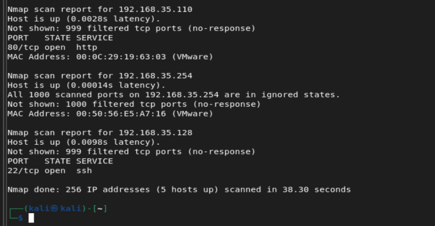
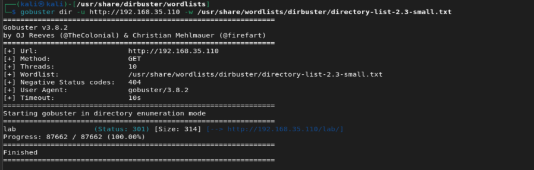

# Xâm nhập ban đầu (Initial Access)

Phần này trình bày quá trình trinh sát và khai thác các dịch vụ trong môi trường thử nghiệm nhằm đạt được quyền truy cập ban đầu vào hệ thống.

## 1. Trinh sát mạng (Network Reconnaissance)

**Mục tiêu:** Thu thập thông tin về các máy chủ đang hoạt động, cổng mạng mở và dịch vụ được triển khai trong hệ thống.

### Hình ảnh thực nghiệm
Dùng Nmap để tiến hành scan các service đang chạy

Dùng gobuster để tiến hành dò các thư mục ẩn

## 2. Tấn công dò mật khẩu (Brute Force)

**Mục tiêu:** Mô phỏng kỹ thuật dò mật khẩu đối với các dịch vụ được triển khai trong môi trường thử nghiệm.

### Hình ảnh thực nghiệm

## 3. Khai thác lỗ hổng File Upload to RCE

**Mục tiêu:** Khai thác chức năng tải tệp thiếu an toàn nhằm đạt được quyền truy cập ban đầu vào hệ thống thử nghiệm.

### Hình ảnh thực nghiệm

