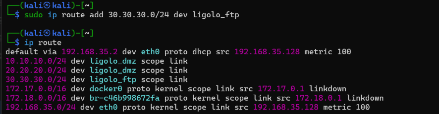

# Hoạt động sau khai thác (Post-Exploitation)

Phần này trình bày các hoạt động được thực hiện sau khi đạt được quyền truy cập ban đầu vào hệ thống.

## 1. Trinh sát nội bộ (Internal Reconnaissance)

**Mục tiêu:** Thu thập thông tin về máy tính đã truy cập, người dùng, tiến trình và môi trường mạng nội bộ.

## 2. Leo thang đặc quyền (Privilege Escalation)

**Mục tiêu:** Nghiên cứu và mô phỏng các phương pháp khai thác cấu hình sai hoặc điểm yếu bảo mật nhằm nâng cao quyền truy cập.

## 3. Thiết lập Multi-Pivoting

https://github.com/noname2kz/Enterprise-Honeynet-Lab/blob/main/Attack-Simulation/assests/postex02.png
