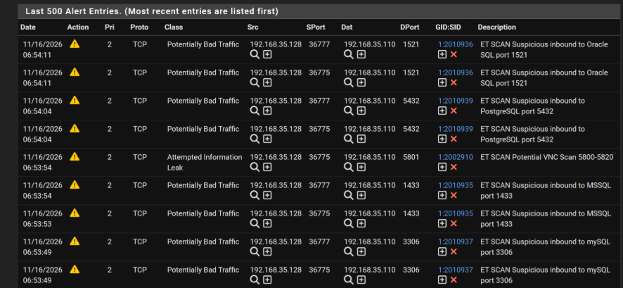
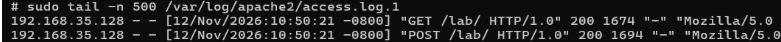

# Phân tích nhật ký mạng (Network Log Analysis)

Phần này trình bày quá trình giám sát và phân tích lưu lượng mạng thông qua Suricata nhằm phát hiện các hoạt động bất thường trong môi trường Honeynet.

## 1. Giám sát lưu lượng mạng

**Mục tiêu:** Theo dõi các kết nối mạng giữa các máy chủ, xác định nguồn, đích và các dịch vụ được truy cập.

## 2. Phân tích cảnh báo Suricata

**Mục tiêu:** Phân tích các cảnh báo được Suricata ghi nhận trong quá trình mô phỏng tấn công.

## 3. Kết quả phân tích

- Xác định các kết nối mạng đáng chú ý.
- Ghi nhận các cảnh báo liên quan đến hoạt động tấn công.
- Phân tích địa chỉ IP nguồn, IP đích, cổng và loại lưu lượng.
- Đối chiếu thời điểm cảnh báo với các hoạt động mô phỏng tấn công.
