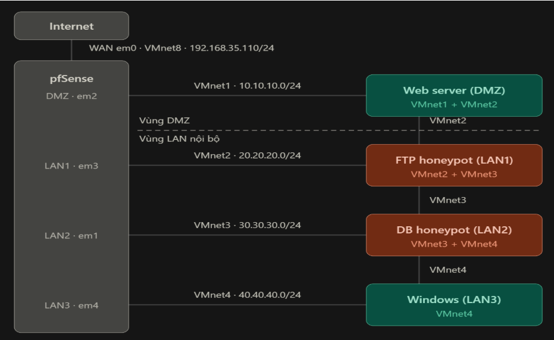

# Xây dựng hệ thống Honeynet mô phỏng doanh nghiệp

## Tổng quan

Dự án tập trung vào việc nghiên cứu, thiết kế và triển khai hệ thống Honeynet nhằm mô phỏng hạ tầng mạng doanh nghiệp và các hoạt động tấn công trong thực tế.

Hệ thống sử dụng pfSense làm Firewall và Router, Suricata để giám sát lưu lượng mạng, kết hợp với các máy chủ Linux và Windows để xây dựng nhiều phân vùng mạng và các dịch vụ Honeypot.

## Công nghệ sử dụng

- pfSense
- Suricata
- Linux
- Windows
- VMware

## Kiến trúc mạng

Hệ thống được chia thành nhiều phân vùng mạng khác nhau:

- **DMZ:** Triển khai các dịch vụ hướng ra bên ngoài và Web Honeypot.
- **LAN1:** Phân vùng mạng nội bộ thứ nhất.
- **LAN2:** Triển khai các dịch vụ FTP Honeypot.
- **LAN3:** Triển khai Database Honeypot & Web Honeypot kết hợp máy Windows 7 Core nhằm lừa hacker tải mã độc về.

## Mô phỏng tấn công

Dự án mô phỏng các giai đoạn khác nhau của một cuộc tấn công:

1. Network Reconnaissance (Trinh sát mạng).
2. Initial Access and Exploitation (Xâm nhập ban đầu và khai thác).
3. Internal Reconnaissance (Trinh sát mạng nội bộ).
4. Lateral Movement (Di chuyển ngang).
5. Log Collection and Analysis (Thu thập và phân tích nhật ký).

## Giám sát và phân tích nhật ký

Suricata kết hợp với nhật ký hệ thống được sử dụng để giám sát hoạt động mạng, phát hiện các dấu hiệu bất thường và phân tích hành vi của attacker trong quá trình mô phỏng tấn công.

## Trạng thái dự án

Nghiên cứu học thuật / Môi trường thực hành và nghiên cứu an toàn thông tin cá nhân.
