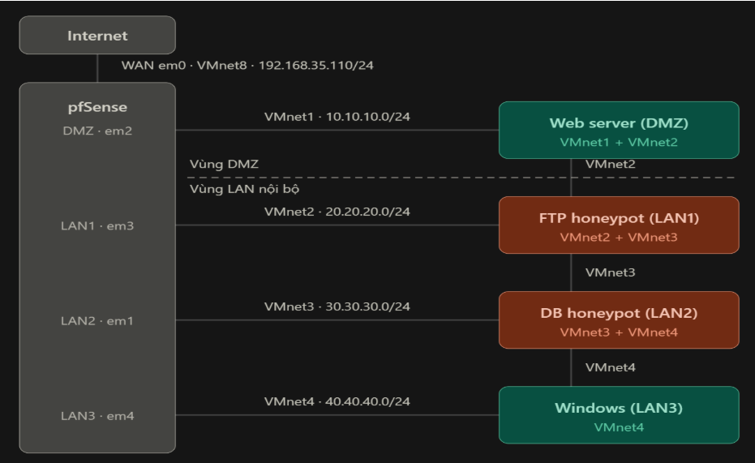

# Kiến trúc mạng và phân vùng hệ thống
Mô hình được thiết kế theo chuẩn phòng thủ chiều sâu (Defense-in-Depth), phân chia thành các vùng mạng độc lập thông qua các card mạng ảo (VMnet) quản lý trực tiếp bởi pfSense Firewall:
# SƠ ĐỒ MẠNG TỔNG THỂ 

